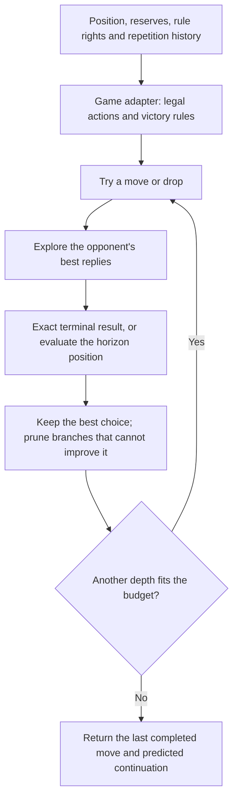

# How the Schness bot works

The bot searches possible futures and chooses the move with the best outcome against strong
replies. The rules adapter defines what is legal and how a game ends; the search algorithm
explores those choices; the evaluator estimates positions when search reaches its horizon.
A better estimate and more search can both improve decisions, but neither guarantees perfect play.

## What a search means

For each candidate move, the bot predicts the opponent choosing their best response. It continues
this process until a win/draw, the requested depth, or a node/time cap. It maximizes the root
player's score and minimizes it on the opposing side's turn. It reads the actual side to move,
so a game with an extra turn does not have to pretend turns alternate.

Terminal rules have priority: checkmate and the active variant's draw conditions are adjudicated
by game rules. At nonterminal horizons, Schness currently scores material, deployment, legal
mobility and check. Bank material counts where the capture policy makes ownership or permanent
loss relevant. The latest performance rounds preserve the same evaluator; they change how
cheaply and efficiently the search obtains its answer.

One **ply** is one player's action. A depth of two includes our move and one opposing reply.
Numeric levels 0–100 request that many future actions, subject to budgets. Level zero uses an
ordered legal fallback without looking at successor positions. Level 100 requests 100 plies;
it is not an Elo, a percentage or a promise to finish that depth. Results expose requested depth,
completed depth and whether a cap stopped search. Incomplete iterations never replace a completed
answer. If no iteration completes, the fallback has no claimed evaluated continuation.

Bounded searches deepen progressively: finish depth one, then two, and so on. Earlier results
help order later searches. Single-line play concentrates on the best choice. Multi-PV analysis
spends more work obtaining exact alternative root scores and returns predicted best-reply lines.
Those lines are useful for a tutor, but are not all possible futures or a proof of a forced win
unless the searched terminal results establish it.

## What changed across the optimization rounds

The engine already used alpha-beta/minimax and position caching before these performance rounds.
We improved both the amount of search and the work required for each visited position.

| Earlier work | Current implementation |
|---|---|
| Root choices often searched with independent wide windows | Share the best known bound across root choices |
| Repeated legal-list generation for adjudication and evaluation | Reuse node facts; count leaf mobility without producing lists |
| Clone position/history for each future move | One owned position, reversible make/unmake, exact restoration in `finally` |
| Recalculate board geometry | Precomputed 16-bit attacks, rays and blocker masks |
| Generate broad candidate lists and reject afterward | Direct generation; early check evasions and absolute-pin filtering |
| Allocate actions repeatedly | Frozen private action values; public legal actions remain independent copies |
| Allocate a mask buffer for each legality test | Reuse a scratch buffer inside each generation call |
| Recalculate unchanged material and serialize history repeatedly | Incremental material/masks/current key; bounded exact history-path identities |
| Basic capture ordering | Best-move hints, capture priority, killer moves and history ordering |
| Wide-window internal searches | Principal variation searches with full re-search when needed |
| Wide-window iterative searches | Aspiration windows that widen or fall back to a full search |
| Copy continuation arrays at many recursive levels | Private immutable linked continuations, flattened for published lines |
| Create per-move ordering wrappers | Reuse a per-search ranking map while preserving move order |

These optimizations preserve the tested fixed-depth minimax scores. Alpha-beta discards a branch
when bounds establish it cannot improve the decision. PVS and aspiration windows retry when a
narrow test is insufficient. Default play does not enable speculative null-move pruning or late-move
reductions. Repetition-sensitive scores do not reuse board-only identities: full rule/history
context remains represented, while history-independent hints can influence order only.

Measured stage-by-stage timings and the latest equal-time games are in
[the round-four report](search-performance-v4-report-2026-10-25.md). Timings are workload/device
specific; more search does not imply an identical percentage increase in playing strength.

## What Stockfish additionally does

Stockfish shares our broad alpha-beta/PVS/iterative-search approach, but uses a much more mature,
selective search and evaluation system. The following are present in its current implementation
and absent or substantially simpler here. This is an architectural comparison, not a benchmark
against standard Stockfish, which does not play Schness rules.

| Technique | Purpose | Schness status / adaptation issue |
|---|---|---|
| Late-move reductions | Initially search less promising moves less deeply | Experimental opt-in only; quiet moves may hide strong threats |
| Null-move pruning | Test whether a position is strong even after passing | Not enabled; passing interacts with zugzwang, cooldowns and charge rights |
| Futility pruning, razoring and ProbCut | Skip work using evaluation margins and reduced tactical tests | Not enabled; needs rule-specific validation |
| Singular extensions | Spend additional depth on a uniquely strong candidate | Not implemented |
| Static exchange evaluation and selective quiescence | Judge capture exchanges and stabilize tactical horizons | Capture/check extension is optional; no SEE implementation |
| Continuation/correction histories and sophisticated TT policies | Improve ordering and evaluation/search reuse | We have simpler per-search bounded maps and history hints |
| Trained NNUE evaluation | Estimate positions with an incrementally updated neural network | We use handcrafted scores; training needs variant-aware features and data |
| Shared-table multithreading | Coordinate several search workers | Our playing search is single-threaded |
| Chess tablebases and extensive statistical testing | Supply exact restricted endgames and validate strength changes | No Schness tablebases; current regression suite and match screens are much smaller |

These mechanisms are documented in the [official search implementation](https://github.com/official-stockfish/Stockfish/blob/master/src/search.cpp),
[terminology](https://official-stockfish.github.io/docs/stockfish-wiki/Terminology.html),
[NNUE documentation](https://official-stockfish.github.io/docs/nnue-pytorch-wiki/docs/nnue.html)
and [Fishtest testing guide](https://official-stockfish.github.io/docs/fishtest-wiki/Creating-my-first-test.html).
Reviewed 2026-10-25. A chess-trained network or pruning policy is not automatically appropriate
for Schness reserves, objectives or new rule rights. A promising next strength project is carefully
measured tactical evaluation/SEE and quiescence, followed by rule-aware learned evaluation and
larger testing. These are proposals, not features silently added by this optimization round.

## Can this support other games and more players?

The current search supports deterministic, sequential, two-sided, zero-sum games with perfect
information. Its adapter supplies actions, state changes, side to move, terminal scores, heuristic
scores and complete state identity. Schness-specific 4×4 acceleration stays inside the adapter;
the search itself can work on a different board or no board. Existing tests include take-away
games, tic-tac-toe, changed objectives and extra turns.

Multiplayer, chance, hidden information and simultaneous moves are deferred. Current work
concentrates on the correctness, tactical quality and browser efficiency of the two-player engine.

## Latest stepwise work

The next round adds a king-safety proof that avoids simulating ordinary non-king moves after
complete pin/check-evasion filtering, plus per-search stack buffers for attack masks. These
preserve the exact default scores. King moves and malformed multi-king boards retain full checks.

Optional `quiescenceChecks: true` expands the existing tactical horizon through legal checks,
including checking drops, when `quiescenceDepth` is positive. `lateMoveReduction: true` is an
experimental selective mode: later quiet board moves may first be searched one ply less deeply;
promising results receive a full-depth search. A reduced fail-low can miss a full-depth tactic,
so this is not an exact-mode replacement. Both new switches are false by default.

See [the round-five report](search-performance-v5-report-2026-10-25.md) for staged measurements,
match results, and decisions about which changes remain experimental.
